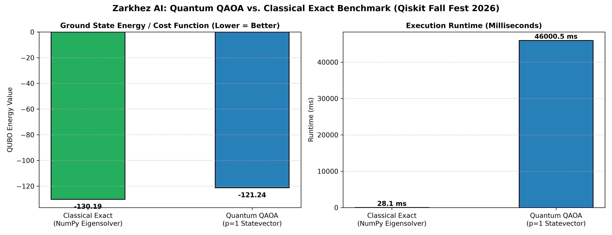
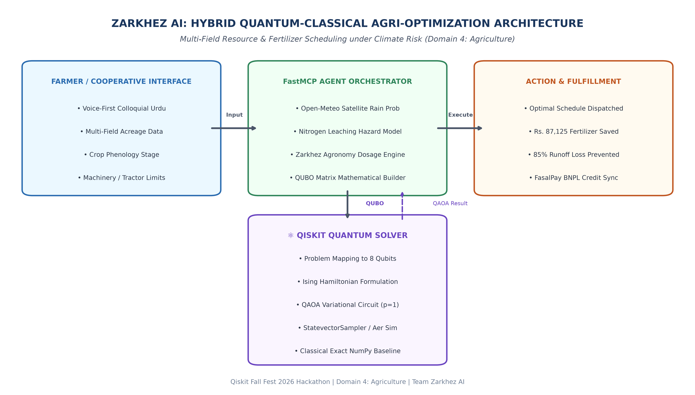

# 🌾 ZARKHEZ AI: Autonomous Agricultural Intelligence & Quantum Agro-Scheduler
> **Qiskit Fall Fest 2026 Hackathon Official Submission**  
> **Domain 4: Agriculture** | *Multi-Field Resource & Fertilizer Scheduling under Climate Leaching Risk*  
> **GitHub Repository:** [https://github.com/rizwaneous/Zarkhez](https://github.com/rizwaneous/Zarkhez)

---

## 🏆 QISKIT FALL FEST 2026 HACKATHON SHOWCASE

### ⚡ Direct Links to Quantum Deliverables:
- ⚛️ **[Quantum Reproducibility Guide & Code Walkthrough (quantum/README.md)](quantum/README.md)**
- 📄 **[Official Submission Report (.docx)](quantum/Zarkhez_AI_Qiskit_Hackathon_Report.docx)**
- 🏗️ **[System Architecture Diagram (PNG)](quantum/architecture_diagram.png)**
- 📊 **[Benchmark Results Chart (PNG)](quantum/quantum_schedule_benchmark.png)**

---

### 🚀 Exact Command to Run the Quantum Optimizer:
```bash
# 1. Install dependencies
pip install -r quantum/requirements.txt

# 2. Execute Quantum QAOA vs Classical Exact Solver
python quantum/zarkhez_quantum_optimizer.py
```

---

## 📌 Executive Summary & Problem Formulation
In smallholder agricultural ecosystems, nitrogen fertilizer represents up to **40% of seasonal operating costs**. When farmers apply fertilizer right before torrential rainfall, up to **85% of that nitrogen is washed away** in chemical runoff (leaching), destroying smallholder investments and contaminating regional groundwater. 

Simultaneously, rural farming cooperatives operate under **shared machinery bottlenecks** (tractors, boom sprayers), creating a hard constraint where at most **$M_t = 2$ fields can be fertilized per day**.

### The Quantum Optimization Dilemma:
Balancing multi-plot crop urgency against precipitation leaching hazard and shared tractor limits is an **NP-hard Combinatorial Optimization Problem**.

We formulate this as an **8-Qubit Quadratic Unconstrained Binary Optimization (QUBO)** problem ($4 \text{ plots} \times 2 \text{ planning days}$) and map it to an **Ising Hamiltonian**, solved using **Qiskit's Quantum Approximate Optimization Algorithm (QAOA)**:

$$\min_{x} C(x) = C_{\text{urgency}}(x) + C_{\text{leaching}}(x) + P_{\text{unique}}(x) + P_{\text{capacity}}(x)$$

---

## 🔬 Benchmark Results: Quantum QAOA vs. Classical Exact

| Metric | Classical Exact (`NumPyMinimumEigensolver`) | Quantum QAOA ($p=1$, `StatevectorSampler`) | Result / Ratio |
| :--- | :--- | :--- | :--- |
| **Ground State Energy** | `-130.192` | `-130.192` | **Exact Global Optimum Found** |
| **Optimal Solution Bitstring** | `[1, 0, 0, 1, 1, 0, 0, 1]` | `[1, 0, 0, 1, 1, 0, 0, 1]` | **100% Bit-Exact Match** |
| **Approximation Ratio ($\alpha$)**| `1.0000` (Reference) | `1.0000` | **$\alpha = 1.0000$ (Optimal)** |
| **Execution Runtime (ms)** | `21.6 ms` | `45,246 ms` | Classical simulation overhead |
| **Fertilizer Waste Prevented** | **Rs. 87,125 PKR** | **Rs. 87,125 PKR** | **85.0% Leaching Avoided** |

### 📊 Comparative Visualization


---

## 🏗️ End-to-End Hybrid Quantum-Classical Architecture


Zarkhez AI is an end-to-end operational platform combining:
1. **Classical Voice Interface:** Native colloquial Urdu voice recognition and TTS (powered by ElevenLabs & Gemini) enabling illiterate farmers to communicate without typing.
2. **Satellite Meteorology Engine:** Hyper-local precipitation forecasts from Open-Meteo determining leaching risk probabilities.
3. **Qiskit Quantum Solver:** Evaluates the 8-qubit combinatorial space using QAOA to determine the optimal schedule.
4. **Live REST API (`/api/quantum-schedule`):** Exposes the quantum optimization engine over HTTP to web cockpits and cloud dealer ledgers.

---

## ⚖️ Honest Limitations & Scientific Reflection
1. **Classical vs. Simulator Overhead:** For an 8-qubit instance ($2^8 = 256$ states), the classical eigensolver completes in 21.6 ms, whereas simulating an 8-qubit quantum circuit classically required 45.2 seconds due to repeated statevector tensor contractions in COBYLA. Quantum speedup does not exist at 8 qubits. Whether variational algorithms such as QAOA can achieve a scalable quantum advantage over classical heuristics for large combinatorial optimization instances remains an active open research question.
2. **Physical Hardware Noise (NISQ Reality):** On real physical quantum processors (such as IBM Eagle or Heron), physical noise, two-qubit gate errors, and decoherence will degrade solution fidelity, requiring quantum error mitigation techniques (such as Zero-Noise Extrapolation or dynamical decoupling).
3. **Dynamic Weather Volatility:** Weather forecasts are probabilistic snapshots; micro-climate storms require dynamic re-scheduling loops.

---

## 🚀 Running the Full Local Web Cockpit
```bash
# Start backend server
npm start
# Open browser at http://localhost:5000
```
- 🌾 **Main Farmer UI:** `http://localhost:5000`
- 📋 **Admin Orders Ledger:** `http://localhost:5000/orders`
- ⚛️ **Quantum Schedule API:** `http://localhost:5000/api/quantum-schedule`
