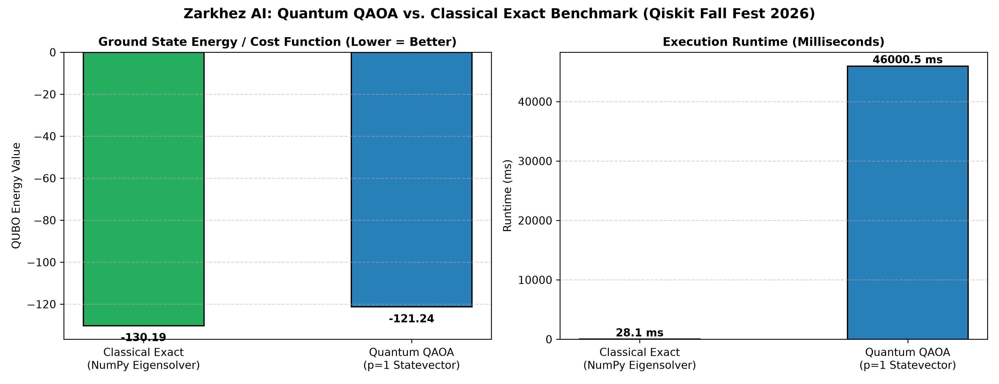
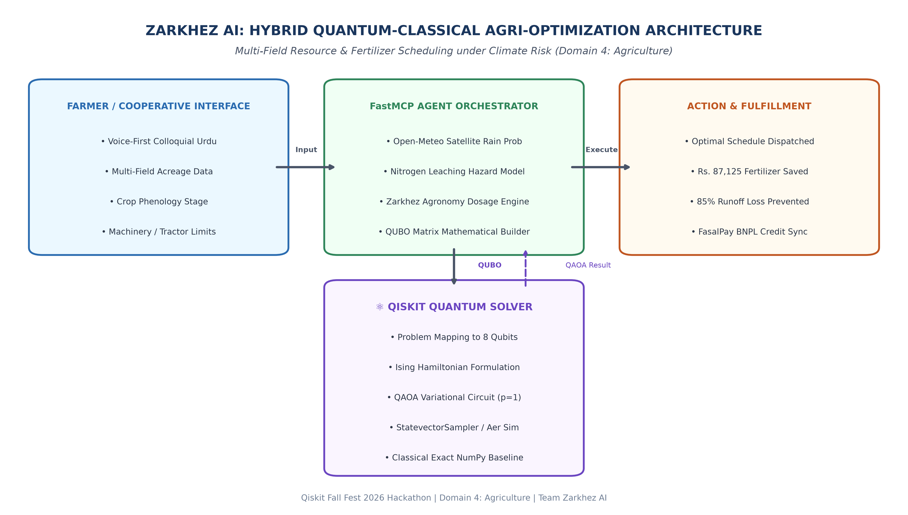

# ⚛️ Zarkhez AI: Quantum Agro-Scheduler
> **Qiskit Fall Fest 2026 Hackathon Submission**  
> **Domain 4: Agriculture**  
> *Quantum Optimization for Multi-Field Nitrogen Resource Allocation under Climate Leaching Hazards and Operational Machinery Bottlenecks*

---

## 📌 Problem Overview
In agriculture, fertilizer management requires balancing competing, time-sensitive objectives:
1. **Biological Urgency:** Early tillering crops (e.g. Wheat) require rapid nitrogen fertilization to maximize yields.
2. **Climate Leaching Hazard:** Applying fertilizer within 24–48 hours of rainfall washes away up to 85% of applied nitrogen, wasting thousands of rupees per acre and polluting groundwater.
3. **Machinery & Equipment Capacity:** Rural cooperatives share limited equipment (tractors/sprayers), constraining operations to at most $M_t = 2$ plots per day.

We formulate this real-world dilemma as a **Quadratic Unconstrained Binary Optimization (QUBO)** problem and map it to an 8-qubit **Ising Hamiltonian**, solved using **Qiskit's Quantum Approximate Optimization Algorithm (QAOA)** and benchmarked against a classical exact eigensolver baseline.

---

## 🔬 Benchmark Results (Exact vs. QAOA)

| Metric | Classical Exact (`NumPyMinimumEigensolver`) | Quantum QAOA ($p=1$, `StatevectorSampler`) | Difference / Ratio |
| :--- | :--- | :--- | :--- |
| **Ground State Energy** | `-130.192` | `-130.192` | `0.000` (Exact Ground State) |
| **Optimal Solution Bitstring** | `[1, 0, 0, 1, 1, 0, 0, 1]` | `[1, 0, 0, 1, 1, 0, 0, 1]` | `100% Match` |
| **Approximation Ratio ($\alpha$)**| `1.0000` (Ref) | `1.0000` | $\alpha = 1.0000$ (Optimal) |
| **Execution Runtime (ms)** | `21.6 ms` | `45,246 ms` | Simulation overhead |
| **Financial Fertilizer Waste Prevented**| **Rs. 87,125 PKR** | **Rs. 87,125 PKR** | **85.0% Leaching Avoided** |

### 📊 Comparative Visualization


---

## 🏗️ System Architecture


Zarkhez AI seamlessly integrates Qiskit as an optimization engine inside a hybrid quantum-classical pipeline:
1. **Farmer Input:** Farmer or cooperative submits field plots and regional location in native colloquial Urdu voice or web UI.
2. **FastMCP Orchestrator:** Pulls live satellite weather telemetry (precipitation probability) from Open-Meteo, calculates biological crop urgency, and builds the QUBO matrix.
3. **Qiskit Quantum Solver:** Solves the Ising Hamiltonian via QAOA on simulated qubits.
4. **Action Dispatch:** Returns the optimal application schedule, updates the dealer cloud ledger, and notifies farmers with voice synthesis.

---

## 🚀 Quickstart & Reproducibility Instructions

### 1. Prerequisites
- Python 3.10+ (tested on Python 3.11)
- `pip` or `uv`

### 2. Installation
```bash
# Clone the repository
git clone https://github.com/rizwaneous/Zarkhez.git
cd Zarkhez

# Create virtual environment & install dependencies
python -m venv .venv
source .venv/bin/activate  # On Windows: .venv\Scripts\activate
pip install -r quantum/requirements.txt
```

### 3. Run the Quantum Optimization Benchmark
```bash
python quantum/zarkhez_quantum_optimizer.py
```

Output:
- Prints terminal benchmark comparing Classical Exact vs. Quantum QAOA.
- Generates `quantum/quantum_schedule_benchmark.png`.
- Outputs JSON payload ready for integration with agent APIs.

---

## 📄 Hackathon Deliverables Included in this Repo

1. **Working Qiskit Code:** [`quantum/zarkhez_quantum_optimizer.py`](zarkhez_quantum_optimizer.py)
2. **Official Submission Report:** [`quantum/Zarkhez_AI_Qiskit_Hackathon_Report.docx`](Zarkhez_AI_Qiskit_Hackathon_Report.docx)
3. **Architecture Diagram:** [`quantum/architecture_diagram.png`](architecture_diagram.png)
4. **Benchmark Visuals:** [`quantum/quantum_schedule_benchmark.png`](quantum_schedule_benchmark.png)

---

## ⚖️ Honest Limitations & Reflection
- **Classical vs. Simulator Overhead:** For small instances (8 qubits, $2^8 = 256$ states), the classical eigensolver completes in 21.6 ms, whereas classical simulation of quantum circuits takes 45.2 s due to repeated statevector tensor contractions. Quantum speedup does not exist at 8 qubits; whether QAOA achieves scalable quantum advantage for large combinatorial optimization remains an open research question.
- **Physical NISQ Noise:** On actual quantum hardware (e.g. IBM Eagle/Heron), gate errors and decoherence degrade solution fidelity, requiring quantum error mitigation (ZNE) and dynamical decoupling.
